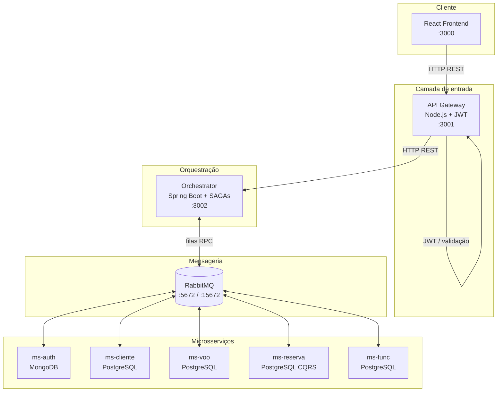

# Sistema de Aeroporto

Plataforma web completa para gestão de voos, reservas e programas de fidelidade, desenvolvida como projeto acadêmico da disciplina **Desenvolvimento de Aplicações Corporativas (DAC)** do curso **TADS — UFPR**.

O sistema simula a operação de uma companhia aérea com dois perfis de usuário — **cliente** e **funcionário** — e expõe fluxos de negócio distribuídos em uma arquitetura de **microsserviços**, com comunicação assíncrona via **RabbitMQ**, orquestração por **SAGAs** e separação de leitura/escrita (**CQRS**) no domínio de reservas.

---

## Sumário

- [Visão geral](#visão-geral)
- [Funcionalidades](#funcionalidades)
- [Arquitetura](#arquitetura)
- [Stack tecnológica](#stack-tecnológica)
- [Estrutura do repositório](#estrutura-do-repositório)
- [Como executar](#como-executar)
- [Serviços e portas](#serviços-e-portas)
- [Padrões e decisões técnicas](#padrões-e-decisões-técnicas)
- [Equipe](#equipe)
- [Contexto acadêmico](#contexto-acadêmico)

---

## Visão geral

O **Sistema de Aeroporto** centraliza a jornada do passageiro — desde o cadastro e login até busca de voos, reserva, check-in e gestão de milhas — e oferece ao funcionário ferramentas operacionais para cadastro de voos, gestão de equipe e confirmação de embarque.

A aplicação foi pensada para refletir cenários reais de sistemas corporativos distribuídos:

- **Frontend desacoplado** consumindo uma API única de entrada
- **Microsserviços** com banco de dados próprio por domínio
- **Orquestrador** coordenando fluxos multi-serviço via SAGAs
- **Mensageria** para desacoplar produtores e consumidores
- **Autenticação centralizada** com JWT no API Gateway

---

## Funcionalidades

### Cliente

| Funcionalidade | Descrição |
|---|---|
| Autocadastro | Criação de conta com validação de dados e senha gerada automaticamente |
| Login / Logout | Autenticação com perfil `CLIENTE` ou `FUNCIONARIO` |
| Tela inicial | Visão consolidada do cliente autenticado |
| Comprar milhas | Aquisição de milhas para uso em reservas |
| Extrato de milhas | Histórico de transações do programa de fidelidade |
| Buscar voos | Pesquisa por data, origem e destino (códigos IATA) |
| Reservar voo | Criação de reserva com débito de milhas |
| Consultar reserva | Busca de reservas por código |
| Cancelar reserva | Cancelamento de reserva existente |
| Check-in | Realização de check-in antes do embarque |

### Funcionário

| Funcionalidade | Descrição |
|---|---|
| Cadastro de voo | Inclusão de novos voos na malha |
| Cancelamento / realização de voo | Alteração do estado operacional do voo |
| Gestão de funcionários | Criar, listar, alterar e remover funcionários |
| Confirmação de embarque | Atualização do estado da reserva para embarcado |

---

## Arquitetura



### Fluxo de uma requisição

1. O **frontend React** envia requisições HTTP ao **API Gateway**
2. O gateway valida o token JWT (quando necessário) e encaminha ao **Orchestrator**
3. O orchestrator executa a **SAGA** correspondente, publicando mensagens no **RabbitMQ**
4. O microsserviço de destino processa a mensagem, persiste no banco e responde
5. A resposta percorre o caminho inverso até o cliente

### SAGAs implementadas

O módulo `orchestrator` concentra a coordenação de fluxos distribuídos:

- `LoginSaga` — autentica no `ms-auth` e busca dados em `ms-cliente` ou `ms-func`
- `CriarClienteSaga` — cadastro distribuído de cliente
- `ComprarMilhasSaga` / `BuscarExtratoMilhasSaga` — programa de fidelidade
- `criarReservaSaga` / `ListarReservasSaga` — ciclo de vida de reservas
- `CriarVooSaga` — cadastro de voos
- `CriarFuncionarioSaga` / `AlterarFuncionarioSaga` / `ListarFuncionarioSaga` — RH operacional
- `ListarClientesSaga` / `BuscarClienteSaga` — consultas de clientes

---

## Stack tecnológica

| Camada | Tecnologias |
|---|---|
| Frontend | React 19, React Router, Axios, React Hook Form, React Toastify |
| API Gateway | Node.js, Express, JWT, CORS |
| Orquestrador | Java 17, Spring Boot 3.5, Spring AMQP |
| Microsserviços | Java 17, Spring Boot 3.5, Spring Data JPA, Spring AMQP |
| Mensageria | RabbitMQ 3 (Management UI) |
| Bancos de dados | PostgreSQL 16 (domínios transacionais), MongoDB 6 (autenticação) |
| Infraestrutura | Docker, Docker Compose |

---

## Estrutura do repositório

```
dac-airport-system/
├── front-end/              # SPA React — telas de cliente e funcionário
├── api-gateway/            # Ponto de entrada HTTP, JWT e roteamento
├── orchestrator/           # SAGAs e coordenação de fluxos distribuídos
└── services/
    ├── ms-auth/            # Autenticação e credenciais (MongoDB)
    ├── ms-cliente/         # Clientes, endereços e milhas (PostgreSQL)
    ├── ms-voo/             # Voos e aeroportos (PostgreSQL)
    ├── ms-reserva/         # Reservas com CQRS (PostgreSQL command + query)
    └── ms-func/            # Funcionários (PostgreSQL)
```

Cada microsserviço possui:

- **Consumers RabbitMQ** para processar comandos assíncronos
- **Banco de dados dedicado** (database-per-service)
- **Dockerfile** próprio para containerização

---

## Como executar

### Pré-requisitos

- [Docker Desktop](https://www.docker.com/products/docker-desktop/) instalado e em execução
- Repositório clonado localmente

### Subir o ambiente completo

Na raiz do projeto:

```bash
# Construir todas as imagens
docker compose build

# Iniciar todos os serviços
docker compose up
```

Aguarde todos os containers subirem. O frontend estará disponível em **http://localhost:3000**.

### Comandos úteis

```bash
# Parar todos os containers
docker compose down

# Ver logs de um serviço
docker compose logs -f api-gateway

# Reconstruir um serviço específico
docker compose build ms-cliente

# Reiniciar um serviço
docker compose restart orchestrator
```

### Problemas comuns

| Problema | Solução |
|---|---|
| Porta já em uso | Verifique processos nas portas 3000–3002, 8080–8084 e 5433–5437 |
| Container não sobe | Confirme que o Docker Desktop está ativo; tente `docker compose down && docker compose up` |
| Erro de permissão (Windows) | Execute o Docker Desktop como administrador; verifique WSL2 |

---

## Serviços e portas

| Serviço | Porta | Descrição |
|---|---|---|
| Frontend | 3000 | Interface web React |
| API Gateway | 3001 | Entrada HTTP + JWT |
| Orchestrator | 3002 | SAGAs e orquestração |
| ms-auth | 8080 | Autenticação |
| ms-cliente | 8081 | Domínio de clientes |
| ms-voo | 8082 | Domínio de voos |
| ms-reserva | 8083 | Domínio de reservas |
| ms-func | 8084 | Domínio de funcionários |
| MongoDB | 27017 | Credenciais de autenticação |
| PostgreSQL (cliente) | 5433 | Dados de clientes |
| PostgreSQL (voo) | 5434 | Dados de voos |
| PostgreSQL (reserva command) | 5435 | Escrita de reservas |
| PostgreSQL (reserva query) | 5436 | Leitura de reservas |
| PostgreSQL (func) | 5437 | Dados de funcionários |
| RabbitMQ AMQP | 5672 | Mensageria |
| RabbitMQ Management | 15672 | Painel administrativo (`user` / `password`) |

---

## Padrões e decisões técnicas

### Database per service

Cada microsserviço mantém seu próprio banco de dados, garantindo isolamento de domínio e evolução independente dos schemas.

### CQRS no ms-reserva

O serviço de reservas separa o modelo de **escrita** (command DB, normalizado) do modelo de **leitura** (query DB, desnormalizado). Eventos publicados no RabbitMQ sincronizam as duas visões via `ReservaEventHandler`.

### SAGA via mensageria

Fluxos que envolvem mais de um serviço (ex.: login autentica em `ms-auth` e busca perfil em `ms-cliente`) são coordenados pelo orchestrator com retry e tratamento de timeout.

### API Gateway como BFF

O gateway centraliza autenticação JWT, validação de payloads e roteamento, protegendo os microsserviços de exposição direta ao frontend.

### Comunicação assíncrona

Produtores e consumidores se comunicam por filas RabbitMQ (`convertSendAndReceive`), desacoplando serviços e permitindo escalabilidade horizontal.

---

## Equipe

Projeto desenvolvido em equipe durante o 5º período de TADS — UFPR (2025):

| Integrante | GRR |
|---|---|
| André Luiz Morais de Brito | GRR20230989 |
| Carlos Eduardo Camargo Viana | GRR20221103 |
| Mariane Roesler | GRR20221105 |
| Pedro Felipe Ribeiro da Silva | GRR20230984 |
| Tiago Pareja Vita | GRR20234975 |

## Contexto acadêmico

| | |
|---|---|
| **Disciplina** | Desenvolvimento de Aplicações Corporativas (DAC) |
| **Instituição** | Universidade Federal do Paraná — TADS |
| **Professor** | Dr. Razer A N R Montaño |
| **Ano** | 2025 |

---

## Convenções de desenvolvimento

<details>
<summary>Branches e commits (equipe interna)</summary>

### Branches

- `main` — branch principal
- `componente/rfxx/nome-da-branch` — uma branch por regra de negócio (ex.: `frontend/rf01/tela-autocadastro`)

### Commits

Inspirado nos [guidelines de Tim Pope](https://tbaggery.com/2008/04/19/a-note-about-git-commit-messages.html):

```
<tipo>(<escopo>): Descrição no imperativo

<corpo opcional>
```

Tipos: `feat`, `fix`, `refactor`, `test`, `docs`, `chore`

Exemplo:

```
feat(R01): implementa a tela de login
```

</details>
